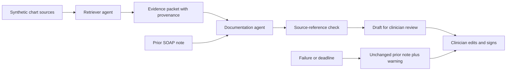

# AI-assisted inpatient rounding note project

> **Synthetic data only. Not for clinical use.** This is a learning and portfolio project. It does not connect to an EHR, use real patient data, or produce clinically validated notes.

## What this project explores

A hospitalist requests an AI-assisted copy-forward progress note before rounds. A retrieval agent is designed to select current, relevant evidence; a documentation agent is designed to turn that evidence into a source-referenced SOAP draft. The clinician reviews, edits, and signs. The system never signs for the clinician.

This repository documents the product lifecycle—from discovery and workflow prototyping through evaluation design and an initial two-agent implementation artifact. The model-backed agents were **not successfully run**: the API account had no credits, and the PM chose not to fund live inference. Quality, latency, and cost targets are therefore **not evaluated**.

## Lifecycle view

| Stage | What happened | How AI was used | PM contribution / status |
|---|---|---|---|
| Discovery | Framed hospitalists/physicians, the pre-round workflow, review/sign-off journey, and initial volume/time assumptions. | Codex helped organize the discovery notes. | PM defined initial users and assumptions; clinicians/SMEs still need to validate them. |
| Ideation and workflow design | Explored **Copy Forward with AI**, source inspection, selective phrase highlights, and a visible failure fallback. | Codex generated a local high-fidelity clickable prototype with simulated responses. | PM reviewed iterations and specified selective highlights; prototype accepted as a workflow artifact, not a working agent. |
| Synthetic data | Created one fictional heart-failure inpatient fixture with chart, prior note, handoff, and transcript; drafted provisional evidence labels. | Codex helped author and inspect synthetic records and draft labels. | PM set scenario intent and evaluation unit; clinical labels remain provisional and require SME review. |
| Requirements and evaluation design | Defined retrieval recall/precision targets of 95%, zero unsupported statements, a 10-second target, retries, fallback, and separate component evaluation. | Codex structured requirements and explained measurement options. | PM selected targets and failure behavior; cost budget was deferred until measurement. |
| Architecture | Separated retrieval from SOAP documentation and added code-owned orchestration, provenance checks, retry policy, and fallback. | Codex drafted the Python implementation and technical documentation. | PM chose to retry only the failed agent, with a shared retry cap and deadline. Architecture remains an initial implementation artifact. |
| Evaluation and release | Recorded the no-paid-inference decision and the distinction between design targets and evidence. | No model-based grading or successful model generation occurred. | PM chose not to buy API credits. Evaluation is explicitly not performed; no quality or ship claim is made. |

## Architecture at a glance



The diagram describes intended flow. The repository contains an initial Python implementation, but the model-backed flow has not completed a successful run. The separate UI prototype uses hard-coded simulated results.

## Portfolio artifacts

- [Product discovery](docs/discovery.md)
- [Requirements and evaluation plan](docs/requirements.md)
- [Decision log](docs/decisions.md)
- [End-to-end case study](docs/case-study.md)
- [Synthetic case 001](data/synthetic_case_001/README.md)
- [Provisional golden-set labels](docs/golden-set.md)
- [Clinician workflow prototype](prototype/index.html)
- [Prototype review notes](docs/prototype-notes.md)
- [Agent implementation notes](docs/implementation-notes.md)
- [Evaluation status](docs/eval-results.md)

## Run the local implementation

The model-backed CLI requires Python dependencies and an OpenAI API key with API billing enabled. It sends the synthetic fixture to the configured model. No key is included in this repository. To avoid paid inference, do not run the CLI; inspect the implementation and the simulated prototype instead.

```powershell
python -m venv .venv
.\.venv\Scripts\Activate.ps1
pip install -r requirements.txt
Copy-Item .env.example .env
# Add OPENAI_API_KEY to .env only if you intend to make paid model calls.
python -m src.rounding_agents.app
```

## Current status and limits

- One synthetic scenario exists; the three-scenario golden set is incomplete.
- Golden-set labels are provisional, not clinician-approved ground truth.
- No successful model response, repeated-run evaluation, confusion matrix, or ship-gate assessment exists.
- The 95% retrieval targets, zero-unsupported-statement target, 10-second target, and cost are design targets or open measures—not achieved results.
- This is not an EHR integration, clinical decision support, or a clinical-use product.

## Sharing

GitHub is a useful way to show the README, decision history, prototype, and case study, but a public repository is optional. Before making it public, review the full repository for secrets and non-synthetic data. This project has not been pushed or published.


## Visual portfolio

Open [the designed lifecycle portfolio](index.html) for the stage-by-stage story and illustrated agent flow. For public sharing steps, see [docs/publishing.md](docs/publishing.md).
